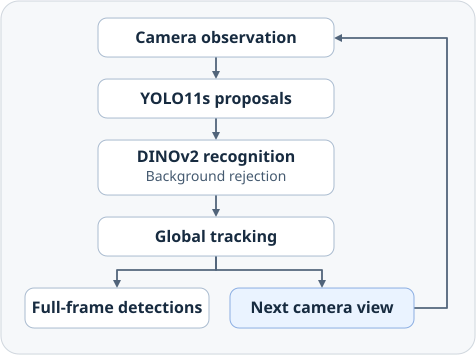

# Drone Flyby · Active Vision

**Aerial object detection with a camera that the model steers.** At each step, a FastAPI service receives one 960 × 540 view of a 4K frame, predicts boxes for the entire frame across 16 classes, and chooses the next view. Zooming in adds detail and reduces coverage, so the pipeline retains tracks outside the current crop.

Nordic AI Cup 2026 team submission by [Mahdi Nasser](https://github.com/mahdinass) and [Robel (@rabrie10)](https://github.com/rabrie10). [Original team repository](https://github.com/rabrie10/Gforce-ai-cup-2026/tree/main/drone-flyby) · [Challenge brief](https://github.com/amboltio/Nordic-AI-Cup-2026/tree/main/drone-flyby)

> This portfolio case study documents the team submission. See the original team repository for source provenance and the reproduction notes for model and data requirements.

## From pixels to the next view

| Stage | Submitted design |
| --- | --- |
| Discovery | A one-class YOLO11s detector proposes candidate boxes. Greedy non-maximum suppression removes overlap before recognition. |
| Recognition | A frozen DINOv2 ONNX encoder feeds a 16-class visual head and a separate target/background head. The submitted classifier admits proposals with a short side of at least 16 pixels. |
| Tracking | Boxes are mapped back to 4K frame coordinates. Per-track velocity, estimated scene drift, and class evidence across views support predictions when a target leaves the crop. |
| Active camera | L0 covers the entire frame. L1 covers one quarter of the frame area and L2 one sixteenth at native resolution. The policy tours L1 regions and uses targeted L2 views for refinement. It reconciles its estimate of camera state with evaluator feedback. |

## What changed after the failure audit

The V6 detector missed visible targets even in zoomed views. V7 retrained discovery on object-centric composites made from masked training objects. The generator varied position, rotation, scale, clipping, occlusion, and shadows across L0/L1/L2-style views. A visibility check rejected composites where the pasted object disappeared into the background. The generated split had **3,600 training and 420 validation images**. The submitted checkpoint came from epoch 15.

### Diagnostic replays

| Measurement | V6 | V7 | Scope |
| --- | ---: | ---: | --- |
| Raw proposals matching annotated targets at IoU ≥ 0.50 | 3/14 | **13/14** | Frozen team annotations on 20 hosted L1/L2 observations, replayed offline |
| Emitted boxes matching targets at IoU ≥ 0.50 | 2/14 | **11/14** | Same diagnostic sample |
| Helsinki replay mAP@0.50 | 0.240 | 0.247 | Local check on a scene used for training and development |

The diagnostic sample is small and was used during development. Some well-localized objects still received unstable class labels. The replay counts describe localization and the local mAP uses the development scene.

### Official Nordic AI Cup results

| Organizer-run evaluation | Score |
| --- | ---: |
| Best official validation | 0.03182 |
| Final evaluation | **0.02464** |

The portal used different data for validation and final evaluation. A camera-clamp variant removed recorded illegal moves in one validation attempt and scored 0.01241. The team reverted it before the final run. The final attempt recorded one transport timeout. These figures come from the [team's captured competition records](https://github.com/rabrie10/Gforce-ai-cup-2026/blob/main/drone-flyby/architecture_experiments/v7_object_centric/OFFICIAL_RESULTS.json).

## Source map and reproduction

| Path in the original `drone-flyby/` tree | Role |
| --- | --- |
| `v5/gpu/endpoint_v6.py` and `v5/gpu/pipeline_v6.py` | FastAPI serving and the tracking/camera pipeline used with the V7 detector |
| `v5/visual_expert.py` and `v5/gpu/discovery_v54.py` | DINOv2 encoding, recognition, and background rejection |
| `architecture_experiments/v7_object_centric/` | Mask extraction, dataset generation, training, and diagnostic replay |
| `tests/` | Baseline, tracking, camera, output schema, and diagnostic-capture tests |

[Reproduction notes](docs/reproduction.md) identify the restored serving revision, dependencies, and checks that can run without the submitted weights. [Provenance and release review](docs/provenance.md) covers attribution, history, and third-party material.

## Credits

Mahdi Nasser implemented the Drone Flyby experiments, perception and camera-control iterations, and the final submission work recorded in Git. Robel (@rabrie10) integrated the competition template into the team repository and contributed to the shared project. The history records Copilot scaffolding and Claude co-author trailers as tooling. Ambolt AI supplied the challenge, starter implementation, evaluator, and Helsinki reference assets. The original repository and history are linked above.
